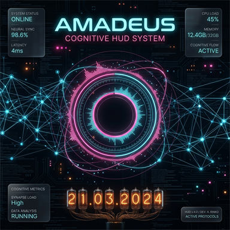

# AMADEUS Convergence Sync HUD

Interactive, sound-reactive Live2D wallpaper starring Makise Kurisu (Steins;Gate). Runs as a **Lively Wallpaper** on Windows and falls back to a browser simulation mode when Lively's API isn't present.



## Features

- **Live2D Kurisu avatar** — mouse-tracking gaze, blinking, breathing, body/head sway, idle eye micro-movements, ambient moods (smile/blush), click/tap interactions, and **audio-reactive lip-sync** that drives her mouth to the music.
- **Living eyes** — her pupils dilate and constrict with emotion and how close you hover near her face, and spike wide on every startle, all smoothed so it reads like an organic gaze shift.
- **Emotion-fidelity face layers** — the model's Smile/Sad/Angry/Surprised/Scared blend shapes stack on top of her expression assets, so each mood reads clearly instead of leaning on a single expression swap.
- **Expression easter eggs** — rare bespoke moments from the model's unused parameters: a playful tongue-out **blep** in calm moods, a welling **tear** when she's sad, an **anger vein** when genuinely annoyed, and a blink-and-you-miss-it **yandere glint**. Plus rare ambient **Special motions** (haru_g_idle / xhiyori_m03) that play once a minute or so when she's unoccupied.
- **Beat-reactive body bob** — on every bass kick she sways and nods along, synced to the same pulse as the audio ring and the ambient particles.
- **Cheek pokes** — tap the side of her face and she puffs up annoyed: blush, a RageSign flicker, a sharp recoil, and a sassy voiced quip.
- **Stage camera** — she fades in with a gentle settle on load, drifts softly with your cursor (parallax), and leans closer when you hover near her face.
- **Voice replies (TTS)** — every line she says (chat replies, greetings, wake/peek lines, idle chatter) is spoken aloud via the browser's `speechSynthesis`. Long replies are chunked per sentence so Chrome's 15s-utterance bug can't cut her off. Toggle in **SYSTEM_OPTS → Voice Replies**.
- **Peek reactions** — when you switch away (window focus loss, Lively pause, lock/screensaver) the HUD dims and she relaxes; when you come back she **peeks** — a glance toward where you returned from, plus a Steins;Gate-flavored greeting.
- **Extended touch moves** — hold-to-pet (press and hold for a blushy, progressively happier reaction), shadow taps (click her feet/shadow for a startled hop), and double-click (startle + return to center stage) — each occasionally with a voiced quip.
- **Beat-reactive ambient particles** — the drifting data dust scatters, flares and shudders on every bass kick, synced to the same beat pulse as the audio ring, with an expanding shockwave ring.
- **Phosphor oscilloscope** — a classic CRT-style scope in the top-right panel with two live traces: the **audio spectrum** (crimson, vertical peaks responding to bass/treble frequencies) and Kurisu's **thought/feeling state** (violet, driven by her emotion engine and thinking/typing/speaking). Both leave a glowing phosphor trail that decays like an old CRT, over a crisp green graticule.
- **Audio spectrum ring** — bass-reactive crimson ring, rotating gears, and a cursor gravitational lens.
- **Type to talk** — chat with Kurisu: press Enter to send, Escape to dismiss. Replies fall back through AMADEUS Brain → canned Steins;Gate-flavored lines (Ollama/OpenRouter are disabled by default to save RAM).
- **Nixie clock** — HH:MM:SS readout with a cathode "pop" on each digit flip.
- **Realtime news feed** — top Hacker News stories (with a standalone simulated pool when offline).
- **Idle power saving** — HUD dims after ~8s of silence; Kurisu falls asleep after ~20 minutes of inactivity and wakes when you return.
- **Time-of-day ambience** — colder "night ops" look between 19:00 and 06:00.

## Install

1. Install [Lively Wallpaper](https://rocksdanister.github.io/lively/).
2. Add a wallpaper from the folder containing this project (the folder with `index.html` and `LivelyInfo.json`), or open `index.html` directly in a browser to preview.
3. For full features Lively launches the wallpaper with `--audio --pause-event --system-nowplaying` (already declared in `LivelyInfo.json`).

## Chat / Brain setup (optional)

Kurisu's replies use the first available tier, in order:

1. **AMADEUS Brain** (local FastAPI) — memory + explicit emotion tags. Set your key in `brain-key.js`:
   ```js
   window.KURISU_BRAIN_KEY = 'your_key_here';
   ```
   The endpoint defaults to `http://127.0.0.1:8000` (see `KURISU_BRAIN` in `wallpaper.js`).
2. **OpenRouter** (cloud, fast, no local GPU cost). Set your key in `openrouter-key.js`:
   ```js
   window.KURISU_OPENROUTER_KEY = 'sk-or-v1-...';
   ```
   Free keys: <https://openrouter.ai/keys>.
3. **Ollama** (local, offline). Starts automatically if the server is up at `http://localhost:11434`.
4. **Canned replies** — offline Steins;Gate-flavored fallback pool.

> **Security:** `openrouter-key.js` and `brain-key.js` are gitignored. Never commit real API keys.

## Interactions

| Action | Result |
| --- | --- |
| Move mouse | Kurisu's eyes track you; the spotlight warms near her face; the audio ring bends toward the cursor |
| Type a message | She notices; **Enter** sends, **Escape** dismisses; typing `hello` triggers the classic lab greeting |
| Click her head / body | She reacts with a motion / expression |
| Click her hands | Cycles arm pose (crossed/straight) with shy blush + random emotional reactions |
| Press and hold on her | Hold-to-pet: blush + soft body motion, progressively happier the more you pet |
| Click her shadow | Startled hop — a distinct reaction from a normal click |
| Double-click her canvas | Surprise + returns to center stage |
| Switch away from the desktop | HUD dims, Kurisu relaxes; on return she peeks and greets you |

## Project structure

| File | Purpose |
| --- | --- |
| `index.html` | HUD markup (clock, oscilloscope, news feed, speech bubble) |
| `style.css` | Theme, panels, animations, idle/reduced-motion handling |
| `wallpaper.js` | Core logic: oscilloscope, audio ring, chat, emotion engine, idle power-saving, news feed, Lively API hooks |
| `live2d_controller.js` | Live2D character controller: lifelike animation loop, emotion engine, proximity awareness, mouse tracking, parameter smoothing, audio-reactive physics, texture LOD switching |
| `lib/`, `live2d/` | PixiJS, Live2D Cubism SDK, and the Kurisu model assets |
| `openrouter-key.js`, `brain-key.js` | Local-only API key placeholders (gitignored) |
| `LivelyInfo.json` | Lively Wallpaper metadata and launch arguments |

## Performance notes

- Canvas backing resolution is capped at a 1.5 device-pixel ratio; the full HUD redraws at most ~30fps, the scope at ~30fps, and the rotating gears at 10fps.
- Idle mode drops the HUD to a dim static frame, disables backdrop blur, and throttles the Live2D ticker.
- A performance governor measures real frame rate and dynamically steps down quality: rendering resolution, audio ring bar count, and texture detail.
- **Texture LOD switching**: the model loads with 4096px textures at full quality; under performance pressure, texture resolution is downsampled to conserve VRAM.
- `prefers-reduced-motion` is respected for CSS animations.

## Live2D enhancements

- **Parameter smoothing**: facial parameters (cheek blush, mouth form) interpolate smoothly between emotion states instead of snapping.
- **Audio-reactive physics**: cloth and hair physics intensify during strong audio beats, returning to base intensity during quiet moments.
- **Audio-reactive lip-sync**: vocal frequency bands drive natural mouth opening/closing with smoothed transitions; mouth form adjusts based on frequency content.
- **Expanded hit areas**: hands are now separate clickable hit areas that toggle an arm-crossed pose with shy blush reactions.
- **New emotion states**: smug, proud, and jealous emotions with custom aura colors and parameter tweaks.
- **Pupil dilation**: the `EyeballSize` parameter is driven live by emotion, cursor proximity to her face, and startle flashes — dilated in wonder, narrowed in anger or sleepiness.
- **Blend-shape face layers**: the Smile/Sad/Angry/Surprissed/Scared blend shapes are written per emotion on top of expression assets for clearer moods.
- **Rare expression easter eggs**: self-scheduling TongueOut/Tears/RageSign/Yandere moments with long, emotion-tied cooldowns (interrupted by speech except for tears/rage).
- **Rare ambient motions**: the Special motion group (haru_g_idle / xhiyori_m03) plays occasionally when she's calm and unoccupied, never during speech, petting, holds, or an active easter egg.
- **Stage camera**: entrance fade-in with a settle on load, cursor-following parallax (±10px, gated while dragging/pet mode), and a proximity zoom up to ~4.5% when hovering her face.
- **Beat bob**: `triggerBeat()` decays a quick side-to-side + forward/back body lean on each bass kick (fed from wallpaper.js's beat detector).
- **Cheek pokes**: spatial face-hit detection in `_onHit` — taps on the lower side of the head trigger a puffed-annoyed reaction with a RageSign flicker and a body recoil instead of a startle.
- **Interactive pet animations**: dragging Kurisu triggers surprise reactions; repeated petting makes her progressively happier.
- **Performance-aware animations**: animation speed and physics intensity scale with the performance governor.
